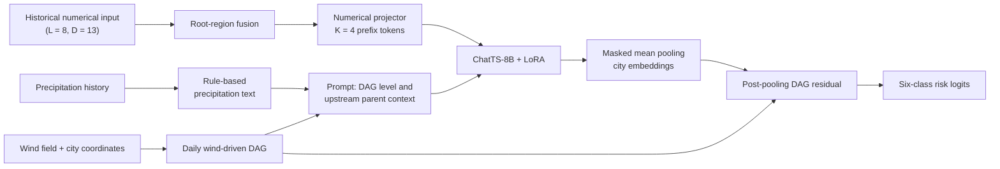

<h1 align="center">AeroMosaic</h1>

<p align="center">
  <strong>Transport-Aware Spatiotemporal Multimodal Learning for Atmospheric Pollution Risk</strong><br>
  Muyang Zheng, Jiaming Ma, Zongyu Zhang, Qingsong Wen
</p>

<p align="center">
  
  
  
  
</p>

<p align="center">
  <a href="#overview">Overview</a> ·
  <a href="#results">Results</a> ·
  <a href="#repository-layout">Layout</a> ·
  <a href="#quick-start">Quick start</a> ·
  <a href="#reproducing-the-paper">Reproduction</a> ·
  <a href="#citation">Citation</a>
</p>

## Overview

AeroMosaic infers the PM<sub>2.5</sub> risk class (six levels) of every city in a region on a target date. It assigns heterogeneous atmospheric signals to distinct paths and fuses them under a daily directed transport prior:

| Signal | Path in AeroMosaic |
|---|---|
| Historical PM<sub>2.5</sub> and time channels | Learnable numerical prefix tokens of the language-model backbone |
| Recent precipitation | Compact rule-based prompt text |
| Wind-driven transport | Daily DAG that selects upstream context and drives post-pooling residual propagation |



> [!NOTE]
> The main results use the oracle parent-label protocol, in which the prompt of each non-root city contains the target-date labels of its DAG parents. The same prompt field also supports no-oracle protocols (no parent context, predicted parent classes, or historical upstream PM<sub>2.5</sub>); see the paper appendix.

## Results

Macro-F1 / Micro-F1 on the six regional benchmarks (mean over seeds 42, 123, 456; 2015–2016 train, 2017 validation, 2018 test). The strongest of thirteen time-series and air-quality baselines is shown for reference.

| Region | AeroMosaic | Strongest baseline |
|---|---|---|
| BTH | **0.7239** / **0.8387** | 0.5255 / 0.6393 |
| YRD | **0.5976** / **0.7671** | 0.4833 / 0.6815 |
| SDP | **0.6218** / **0.8166** | 0.4435 / 0.6103 |
| ZHD | **0.6466** / **0.7861** | 0.5249 / 0.6461 |
| CJD | **0.5499** / **0.8674** | 0.5295 / 0.7777 |
| CYB | **0.6802** / **0.8551** | 0.5258 / 0.7410 |

Per-seed values and the aggregation check are recorded in [`provenance/main_table_abl_AC_aggregate.json`](provenance/main_table_abl_AC_aggregate.json).

## Repository layout

| Path | Contents |
|---|---|
| [`pipeline/`](pipeline) | Training and evaluation code (DAG residual, root-region fusion, root-aware loss, LoRA) |
| [`scripts/`](scripts) | Data preparation, data-contract validation, the six-region runner, and the aggregator |
| [`diagnostics/`](diagnostics) | Oracle-access and no-oracle analyses |
| [`data/bth_no_oracle_source_8x14/`](data/bth_no_oracle_source_8x14) | Prepared BTH input for the no-oracle analyses |
| [`configs/`](configs) | Path template and seeds |
| [`provenance/`](provenance) | Archived launcher, source hashes, and per-seed main-table aggregate |
| [`docs/`](docs) | Reproduction guide, data contract, paper–code alignment, troubleshooting |
| [`ChatTS/`](ChatTS) | Curated upstream ChatTS source (no weights) |

## Quick start

```bash
conda env create -f environment.yml
conda activate aeromosaic-repro
cp configs/paths.example.yaml configs/paths.yaml   # then fill in local paths
python scripts/smoke_test_data_free.py --check-cli
python scripts/run_camera_ready_oracle.py --config configs/paths.yaml --dry-run
```

The backbone is [`bytedance-research/ChatTS-8B`](https://huggingface.co/bytedance-research/ChatTS-8B) at revision `7216a84034063c2d394901fe45d20a1e8d773a1f`. Model weights and processed observations are not included in this repository.

## Reproducing the paper

<details>
<summary><strong>1. Obtain the external inputs</strong></summary>

- Processed KnowAir `his.npz` (13 channels, 184 cities) from the [CauAir repository](https://github.com/PoorOtterBob/CauAir/tree/main/data_knowair/24_24/all).
- Raw `KnowAir.npy` for unstandardized precipitation, following the [PM2.5-GNN dataset instructions](https://github.com/shuowang-ai/PM2.5-GNN#dataset) ([Zenodo DOI 10.5281/zenodo.23339627](https://doi.org/10.5281/zenodo.23339627)).
- City coordinates [`city.txt`](https://github.com/shuowang-ai/PM2.5-GNN/blob/main/data/city.txt) from PM2.5-GNN.
- The ChatTS-8B checkpoint at the revision above.

The 13 channels are PM<sub>2.5</sub>; 2 m temperature, boundary-layer height, K-index, 950 hPa relative humidity, surface pressure; total precipitation; 950 hPa u and v wind, wind speed, wind direction; hour; weekday.

</details>

<details>
<summary><strong>2. Prepare and validate regional bundles</strong></summary>

A bundle is one regional directory with train/validation/test indices, per-date tensors, DAG metadata, city names, parent counts, and prompts.

```bash
python scripts/prepare_camera_ready_data.py --help
python scripts/validate_data_contract.py --bundle /path/to/BTH_bundle --project-root . --region BTH
```

The main table was produced from the experiment-time bundles listed in [`configs/paths.example.yaml`](configs/paths.example.yaml). Their DAG builder settings per dataset are:

| Dataset | Wind estimate | Radius | Alignment | Parent cap | Edge weight |
|---|---|---|---|---|---|
| BTH | Persistence (last historical step) | 600 km | cos θ ≥ 0.25 | 3 | Edge score |
| YRD, SDP, ZHD, CJD, CYB | Target-day mean (forecast proxy) | ≈300 km | θ ≤ 60° | None | Binary |

[`scripts/prepare_camera_ready_data.py`](scripts/prepare_camera_ready_data.py) builds new bundles for all six regions with persistence wind, a 600 km radius, cos θ ≥ 0.25, at most three parents, and binary edges. See [`docs/data_and_dag_provenance_audit.md`](docs/data_and_dag_provenance_audit.md) for details.

</details>

<details>
<summary><strong>3. Train, evaluate, and aggregate</strong></summary>

```bash
python scripts/run_camera_ready_oracle.py --config configs/paths.yaml
python scripts/aggregate_camera_ready.py \
  --runs-root /path/to/aeromosaic-results \
  --out /path/to/aeromosaic-results/camera_ready_aggregate.json
```

The runner trains and evaluates all six regions with seeds 42, 123, and 456 using [`pipeline/train_balanced_gc_ablation.py`](pipeline/train_balanced_gc_ablation.py) and [`pipeline/eval_dagresidual_ablation.py`](pipeline/eval_dagresidual_ablation.py). The numerical projector receives channels `{0, 11, 12}` (PM<sub>2.5</sub> and time); key settings are learning rate 1e-4, 3 epochs, gradient accumulation 2, LoRA rank 16 / alpha 32, root-region fusion weight 0.8, and root-aware loss weights r<sub>base</sub> = 1.5, e<sub>3</sub> = 2.0, e<sub>4</sub> = 3.0, w<sub>max</sub> = 4.0.

</details>

<details>
<summary><strong>4. No-oracle analyses (BTH)</strong></summary>

```bash
python scripts/validate_bth_no_oracle_bundle.py --release-root .
```

The prepared input in `data/bth_no_oracle_source_8x14` has raw shape `8x14` and is used only for the no-oracle and oracle-access analyses. Builders for each protocol are in [`diagnostics/`](diagnostics) and [`scripts/`](scripts); see [`docs/reproduction.md`](docs/reproduction.md).

</details>

> [!TIP]
> [`docs/reproduction.md`](docs/reproduction.md) gives the complete command sequence, and [`docs/troubleshooting.md`](docs/troubleshooting.md) covers common environment issues.

## Upstream assets

- ChatTS source: <https://github.com/NetManAIOps/ChatTS> (curated subset in [`ChatTS/`](ChatTS), byte-identical to upstream commit `a16ca1a`; see [`ChatTS/AEROMOSAIC_INTEGRATION.md`](ChatTS/AEROMOSAIC_INTEGRATION.md))
- ChatTS-8B model: <https://huggingface.co/bytedance-research/ChatTS-8B>
- PM2.5-GNN / KnowAir: <https://github.com/shuowang-ai/PM2.5-GNN>
- CauAir and processed KnowAir `his.npz`: <https://github.com/PoorOtterBob/CauAir>

Third-party code, data, and model weights remain subject to their original licenses and terms.

## Citation

```bibtex
@inproceedings{zheng2026aeromosaic,
  title     = {AeroMosaic: Transport-Aware Spatiotemporal Multimodal Learning for Atmospheric Pollution Risk},
  author    = {Zheng, Muyang and Ma, Jiaming and Zhang, Zongyu and Wen, Qingsong},
  booktitle = {Advances in Neural Information Processing Systems},
  year      = {2026}
}
```
